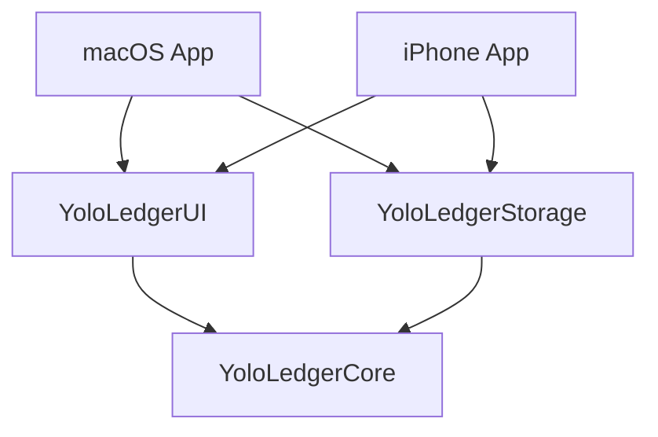

# 工程边界与本地记账

有落使用两个原生 App 入口和三个共享 Swift Packages。M1 建立双端导航骨架，M2 在同一依赖结构中接入本地手动记账。

## 依赖与组装

| 模块 | 职责 | 约束 |
| --- | --- | --- |
| `core-swift` | 账本、分类、收支记录、金额和日期规则，异步 `LedgerRepository` 接口 | 不依赖 UI、数据库或其他本仓库 Package |
| `storage-swift` | `SwiftDataLedgerRepository`，磁盘保存、模型映射、初始化与版本化 schema | SwiftData 模型仅存在于本模块，明确关闭 CloudKit |
| `ui-swift` | 表单、列表、账本选择、页面状态和平台导航 | 只接收 Core 接口，不直接引用数据库 |
| `apps/macos`、`apps/ios` | 平台入口、仓库生命周期和依赖组装 | 注入本机存储；启动失败向用户反馈，不替换成空内存库 |
| `apps/xcode` | 双端 targets、共享 schemes 与本地包引用 | iPhone target 仅面向 iPhone；Mac 使用独立原生 target |

## 数据与写入

- M2 使用人民币单币种。金额以 `Int64` 分保存，输入按十进制字符串解析，禁止浮点转换；收支方向单独存储，单笔金额必须为正。汇总计算检查溢出。
- 账目包含稳定 UUID、账本与分类标识、方向、金额、日期、备注、来源及创建／修改时间。编辑保留原 ID、来源和创建时间。
- Core 定义初始账本与常用收入／支出分类的稳定标识。它们是 M2 初始选项，不代表已经核实喵喵记账的默认分类和账本行为。
- 仓库验证账本、分类存在和分类方向一致后再写入。保存显式落盘；失败回滚未保存变更并向调用方抛出错误。初始化使用独立标记，只执行一次，不覆盖已有名称。
- App 使用 `SwiftDataLedgerRepository.defaultStoreURL()`，默认位于本机应用容器的 `Application Support/YoloLedger/ledger.store`。Mac 与 iPhone 数据独立，无云端账户或同步依赖。
- SwiftData 通过串行 ModelActor 隔离数据库上下文；跨模块传递可发送的值对象。每个活动账库使用一个长期仓库实例。
- 当前建立 V1 `VersionedSchema` 和迁移计划入口；尚无 V2，也未声称完成跨版本升级验收。后续修改 schema 需补迁移与旧数据验证，不能以删除数据库代替迁移。

日期、范围和统计跟随设备当前系统本地时区。日期范围采用包含起点、不含终点的区间，避免边界账目重复计入；日、周、月、年由 Calendar 计算。精确统计与最终交互的完成情况见 TODO。

## 构建与验收边界

使用 Swift 6，临时 deployment target 为 macOS 14 / iOS 17。这是工程构建基线；产品最低支持系统及旧系统兼容性仍待确认，不能用当前机器构建成功代替兼容性验收。

M2 以新增、编辑、删除、列表刷新及重开保留形成手动记账闭环。完整分类管理、周／年统计界面、导入导出、定时记账、备份恢复与快捷指令仍属后续里程碑。未来如需 iCloud，另行评估模型兼容、迁移和同步冲突。

iPhone 最终布局和交互以归档的喵喵记账实际材料为准。当前先接入原生功能流程，不代表已完成参考界面还原。开发进度、实际通过的测试和未验收范围以根目录 [TODO](../TODO.md) 为准。
