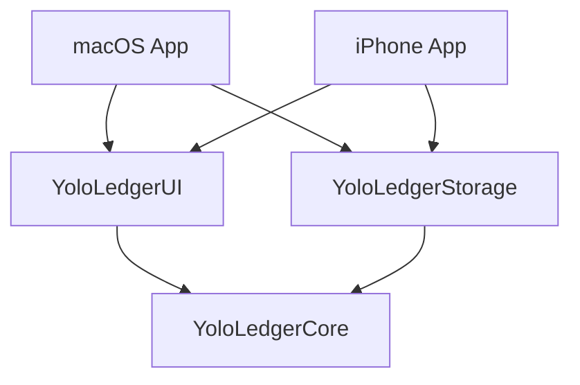

# M1 工程边界

有落使用两个原生 App 入口和三个共享 Swift Packages。当前里程碑建立可运行的双端导航骨架，具体业务与本地保存从 M2 开始实现。

## 依赖与组装

| 模块 | M1 内容 | 约束 |
| --- | --- | --- |
| `core-swift` | `LedgerBook` 与异步读取账本的 `LedgerBookRepository` 接口 | 不依赖 UI、数据库或其他本仓库 Package |
| `storage-swift` | 实现核心接口的 `EmptyLedgerBookRepository` | 仅返回空列表，尚无实际保存、迁移或备份 |
| `ui-swift` | 账单、明细、账本、设置的共享页面与平台导航 | 接收核心接口，不直接引用存储实现 |
| `apps/macos`、`apps/ios` | 平台入口和依赖组装 | 将存储实现注入共享页面 |
| `apps/xcode` | 双端 targets、共享 schemes 与本地包引用 | iPhone target 的设备族仅为 iPhone；Mac 使用独立原生 target |

M1 的账本页面用于验证从 App 组装到共享 UI 再到核心接口的依赖链路。空列表不表示用户数据已经读取或保存；账目新增、编辑、删除、金额和日期计算、具体数据库均未在这一阶段实现。

## 构建与后续演进

M1 使用 Swift 6，临时 deployment target 为 macOS 14 / iOS 17。这是便于建立工程的构建基线，产品最低支持系统仍待确认；不能用当前机器构建成功代替旧系统兼容性验收。

首版本地数据独立保存在各设备。持久化实现随 M2 验证，SwiftData 仍是候选；未来如需 iCloud，再扩展存储实现和迁移方案。日期与统计跟随各设备当前系统本地时区，具体计算随业务实现测试。

iPhone 最终布局和交互以归档的喵喵记账实际材料为准。M1 使用中文占位页面验证工程与导航，不代表已完成参考界面还原。

开发进度和实际验收结果以根目录 [TODO](../TODO.md) 为准。
